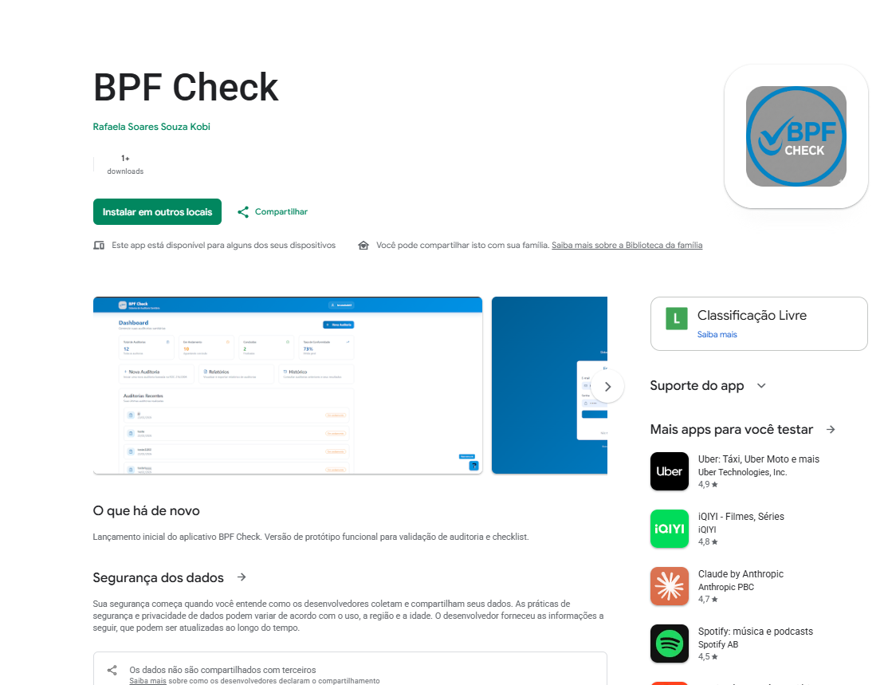
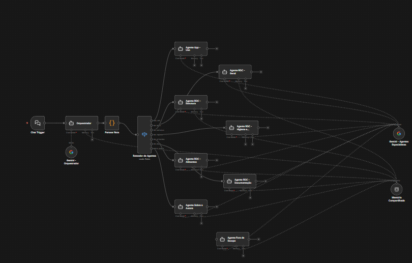

# BPF Check — Sistema de Auditorias Sanitárias


[](https://play.google.com/store/apps/details?id=app.netlify.bpfcheck.twa)


[](https://play.google.com/store/apps/details?id=app.netlify.bpfcheck.twa)

O **BPF Check** é uma aplicação web progressiva (PWA) desenvolvida para facilitar o gerenciamento e a execução de auditorias sanitárias em estabelecimentos de alimentação, baseada nas normas da **RDC 216/2004** da ANVISA.

O sistema suporta funcionamento **offline-first** — auditorias podem ser realizadas sem conexão com a internet e sincronizadas automaticamente ao reconectar.

---

## Funcionalidades

- **Dashboard Interativo** — Visão geral com estatísticas (total, em andamento, concluídas e taxa de conformidade)
- **Auditorias por Seção** — Navegação por seções do checklist RDC 216/2004 com progresso individual
- **Auto-save** — Respostas e observações salvas automaticamente a cada interação
- **Fotos por Item** — Captura de fotos diretamente pelo dispositivo para evidências
- **Modo Offline** — Abre e funciona sem internet (inclusive a primeira tela); auditorias, respostas, observações e fotos ficam no aparelho e são enviadas sozinhas ao reconectar
- **PWA Instalável** — Disponível na Google Play Store e instalável em qualquer dispositivo

---

## Tecnologias

| Camada | Tecnologia |
|---|---|
| Frontend | React 18 + TypeScript + Vite (hospedado no Netlify) |
| Estilização | Tailwind CSS + shadcn/ui |
| Backend | API própria em FastAPI (`api/`) na vpsrafa — `https://bpfcheck-api.brunokobi.tech` |
| Banco | PostgreSQL 16 (container dedicado) + fotos em volume Docker |
| Offline | IndexedDB (Dexie.js) + service worker (vite-plugin-pwa/Workbox) |
| Chat IA | n8n na vpsrafa, via função Netlify `/.netlify/functions/chat` |

> Até a versão 1.x o backend era o Supabase. A migração está descrita em [Migração do Supabase](#migração-do-supabase).

---

## Offline-First

O banco local do aparelho é a fonte de verdade da interface; a API só alimenta esse banco e recebe as alterações.

- **App shell em cache** — o service worker (`sw.js`, gerado pelo `vite-plugin-pwa`) guarda HTML/JS/CSS/ícones, então o app abre sem internet, inclusive dentro da TWA da Play Store.
- **Banco local** (`src/lib/localdb.ts`, Dexie `bpfcheck`) — checklist, auditorias, respostas, fotos e a fila de envio (`outbox`).
- **IDs gerados no aparelho** — auditorias e fotos usam `crypto.randomUUID()`, então não existe "ID temporário" para remapear.
- **Fila única** (`src/lib/sync.ts`) — toda alteração vira uma operação idempotente (`PUT`) enviada em ordem; repetir é seguro. Roda ao abrir o app, ao reconectar, ao voltar para a aba e a cada 30 s. Falha temporária (rede, 5xx) para a fila e tenta depois; erro de validação tira a operação da fila e aparece um aviso com "Tentar novamente".
- **Conflitos** — cada resposta leva o horário do aparelho; o servidor só aceita a versão mais nova (last-write-wins por item).
- **Fotos** — reduzidas para no máximo 1600px (JPEG 80%) antes de guardar e enviar.
- **Checklist** — baixado a cada abertura online; é preciso abrir o app online uma vez antes de usar offline.
- **Versão antiga** — na primeira abertura, `src/lib/legacy.ts` importa o que tinha ficado preso nas filas offline da versão 1.x.

---

## Como Rodar

**Pré-requisitos:** Node.js 18+ e Python 3.12 (só para a API)

```bash
# Frontend (http://localhost:8080) — aponta para a API de produção por padrão
npm install
npm run dev

# Para usar uma API local: crie .env.local com
# VITE_API_URL=http://localhost:8000

# Build de produção
npm run build
```

API e testes (Postgres embutido via `pgserver`, não precisa de Docker):

```bash
cd api
python3.12 -m venv .venv && . .venv/bin/activate
pip install -r requirements.txt -r requirements-dev.txt
pytest -q
```

---

## Backend — API própria

Código em `api/` (FastAPI + psycopg). O schema fica em `api/schema.sql` e é aplicado na subida da API (idempotente).

| Rota | Função |
|---|---|
| `POST /auth/signup`, `POST /auth/login`, `GET /auth/me` | Cadastro/login com e-mail e senha (bcrypt), token JWT de 60 dias renovado a cada abertura online |
| `POST /auth/password` | Troca de senha pelo próprio usuário |
| `POST /admin/reset-password` | Admin redefine a senha de alguém (não há envio de e-mail) |
| `GET /checklists/{id\|default}` | Checklist com seções e itens |
| `GET /audits`, `GET /audits/{id}` | Lista (com contagens e conformidade) e detalhe com respostas e fotos. Admin vê todas |
| `PUT /audits/{id}` | Cria/atualiza auditoria (id gerado no app) |
| `PUT /audits/{id}/items` | Grava respostas em lote (last-write-wins por `updated_at`) |
| `POST /audits/{id}/finalize` | Valida o checklist completo e conclui (409 se incompleto) |
| `PUT /audits/{id}/items/{itemId}/images/{imageId}` | Upload de foto (idempotente) |
| `GET /files/{imageId}?exp&sig` | Foto via URL assinada (HMAC, 7 dias) — o storage não é público |

### Tabelas

```
users (e-mail, nome, hash bcrypt, role admin|user)
checklists └── checklist_sections └── checklist_items
audit_locations ── users
audits ── users, checklists, audit_locations
  └── audit_items ── checklist_items   (UNIQUE audit_id + checklist_item_id)
        └── audit_item_images          (arquivo no volume /data/uploads)
```

Resumo de conformidade (antes `audit_summary`) é calculado na consulta. Perfis e papéis (antes `profiles`/`user_roles`) foram unificados em `users`.

---

## Deploy

### API na vpsrafa

```bash
# na VPS (ver ~/vpsOracleBruno para acesso)
mkdir -p ~/apps/bpfcheck-api && cd ~/apps/bpfcheck-api
# copiar o conteúdo de api/ para cá
cp .env.example .env && chmod 600 .env   # preencher POSTGRES_PASSWORD e JWT_SECRET (openssl rand -hex 32)
docker compose up -d --build
curl https://bpfcheck-api.brunokobi.tech/health
```

O roteamento é feito pelo Traefik do Coolify via labels (rede `coolify`), domínio coberto pelo wildcard `*.brunokobi.tech` do Cloudflare.

### Frontend no Netlify

O frontend continua em `bpfcheck.netlify.app` — a TWA da Play Store (`app.netlify.bpfcheck.twa`) depende desse domínio. Variáveis do site no Netlify:

| Variável | Valor |
|---|---|
| `VITE_API_URL` | `https://bpfcheck-api.brunokobi.tech` (opcional, já é o padrão) |
| `N8N_CHAT_WEBHOOK_URL` | Opcional — padrão: `https://n8n.brunokobi.tech/webhook/bpf-check-webhook-001/chat` |

### Migração do Supabase

**Automática, no primeiro login (em uso):** sem a senha do banco. Na subida, a API importa o checklist RDC 216 das tabelas públicas do Supabase. Quando alguém entra pela primeira vez, a senha é conferida no Supabase e a conta é criada com o **mesmo id e a mesma senha**. Com o token dessa sessão, a API copia as auditorias, respostas, locais e fotos que a pessoa enxerga (o admin traz os de todos). Se a cópia falhar, ela é refeita no login seguinte. Configuração: `SUPABASE_URL` e `SUPABASE_KEY` (chave pública) no `api/docker-compose.yml`. Para isso funcionar, o projeto Supabase precisa continuar ativo; o keepalive da vpsrafa já faz isso.

**Manual, com a senha do banco (alternativa):**

Script `api/scripts/migrate_from_supabase.py`: copia usuários (com a mesma senha), checklist, locais, auditorias, respostas e fotos, preservando os ids. Pode ser repetido.

```bash
docker compose exec -e SUPABASE_DB_URL='postgresql://postgres:<senha>@db.<ref>.supabase.co:5432/postgres' \
  bpfcheck-api python scripts/migrate_from_supabase.py --dry-run   # depois sem --dry-run
```

---

## Agente de IA — n8n Multi-Agent

O BPF Check conta com um assistente inteligente construído no **n8n** com arquitetura **multi-agente**, alimentado pelo modelo gratuito **NVIDIA Nemotron** via **OpenRouter**. O agente responde dúvidas sobre o uso do app e sobre a **RDC 216/2004** diretamente pelo chat.



### Como funciona

A mensagem do usuário passa por um pipeline de 4 etapas:

```
Chat Trigger → Orquestrador → Parsear Rota → Roteador → Agente Especialista
```

**1. Orquestrador**
Recebe a mensagem e classifica a intenção, retornando um JSON de roteamento. Não responde diretamente — apenas decide para qual agente encaminhar.

**2. Parsear Rota**
Nó de código JavaScript que extrai a rota do JSON gerado pelo orquestrador, com fallback para `APP_USO` em caso de erro de parse.

**3. Roteador de Agentes**
Switch que direciona para um dos 8 agentes especialistas conforme a intenção detectada.

**4. Agentes Especialistas**

| Agente | Responsabilidade |
|---|---|
| **App — Uso** | Dúvidas sobre login, checklists, relatórios, perfis e uso geral do app. Também recebe saudações e mensagens genéricas |
| **RDC — Geral** | Fundamentos da RDC 216/2004: objetivo, âmbito, definições e contexto legal |
| **RDC — Estrutura** | Seção 4.1: edificação, instalações, equipamentos, móveis e utensílios |
| **RDC — Higiene** | Seções 4.2, 4.5, 4.6: manipuladores, controle de pragas e resíduos |
| **RDC — Alimentos** | Seções 4.7–4.10: matérias-primas, preparo, armazenamento e exposição |
| **RDC — Documentação** | Seções 4.11–4.12: Manual de Boas Práticas, POPs e responsabilidade |
| **Sobre a Autora** | Informações sobre Rafaela Soares Souza Kobi, o TCC e o Guia Alimentar BR |
| **Fora de Escopo** | Responde educadamente que o assunto está fora do escopo do assistente |

### Memória compartilhada

Todos os agentes compartilham a mesma **Buffer Window Memory**, mantendo o contexto da conversa independentemente de quantas trocas de agente ocorrerem na sessão.

### Onde roda

Workflow `bpfCheck_multiagent` (id `kjLEY3S5CPJe4tAu`) ativo no n8n da vpsrafa desde 07/11/2026. Versionado em `n8n/bpfcheck-multiagent.workflow.json`, sem ids de credencial.

- **Webhook** (valor de `N8N_CHAT_WEBHOOK_URL` no Netlify): `https://n8n.brunokobi.tech/webhook/bpf-check-webhook-001/chat`
- **Modelo:** `nvidia/nemotron-3-ultra-550b-a55b:free` (temperatura 0.2) nos nós "OpenRouter - Orquestrador" e "OpenRouter - Agentes Especialistas", com a credencial `OpenRouter (JARVIS)`, a mesma do chat do Bruno. O limite diário do plano gratuito do OpenRouter é por conta, então é dividido entre os dois chats.
- **Reimportar:** `docker exec n8n n8n import:workflow --input=<arquivo>` (o JSON precisa de `id` e da credencial com `id`) + `n8n publish:workflow --id=kjLEY3S5CPJe4tAu` + `docker restart n8n`. Mudanças pela CLI só valem depois de reiniciar.

### Tecnologias do agente

- **n8n** — Orquestração do fluxo
- **OpenRouter (NVIDIA Nemotron, plano gratuito)** — LLM do orquestrador e de todos os agentes especialistas
- **LangChain nodes** — Integração de agentes, memória e LLM no n8n

---

## Trabalho Acadêmico

O BPF Check foi desenvolvido como **Trabalho de Conclusão de Curso** da Pós-Graduação *lato sensu* em **Controle de Qualidade e Segurança de Alimentos** do Instituto Federal do Espírito Santo — **Ifes Campus Piúma** (2025).

> **KOBI, Rafaela Soares Souza; RIBEIRO, Monique Lopes.** Desenvolvimento de aplicativo móvel para auditoria de boas práticas em serviço de alimentação. *Trabalho de Conclusão de Curso (Pós-Graduação lato sensu em Controle de Qualidade e Segurança de Alimentos)* — Instituto Federal do Espírito Santo, Campus Piúma, 2025.

### Resumo

A segurança dos alimentos é um tema central em saúde pública, cuja garantia depende da implementação eficaz das Boas Práticas de Fabricação (BPF). O monitoramento tradicional baseado em formulários de papel apresenta limitações que dificultam a rastreabilidade, atrasam a geração de laudos e reduzem a agilidade na correção de não conformidades.

O BPF Check digitaliza os requisitos da **RDC nº 216/2004** em listas de verificação interativas com registro fotográfico em tempo real, integrando um **assistente de Inteligência Artificial** para suporte técnico durante inspeções em campo.

A validação empírica com profissionais de Nutrição pelo protocolo **System Usability Scale (SUS)** atestou escore de **81,4 pontos** — classificação de excelência em usabilidade.

**Palavras-chave:** Boas Práticas de Fabricação · RDC nº 216/2004 · Segurança alimentar · Auditoria sanitária · Aplicativo móvel

---

## Créditos

Desenvolvido por **Bruno Kobi** para **Rafaela Soares Souza Kobi**.
